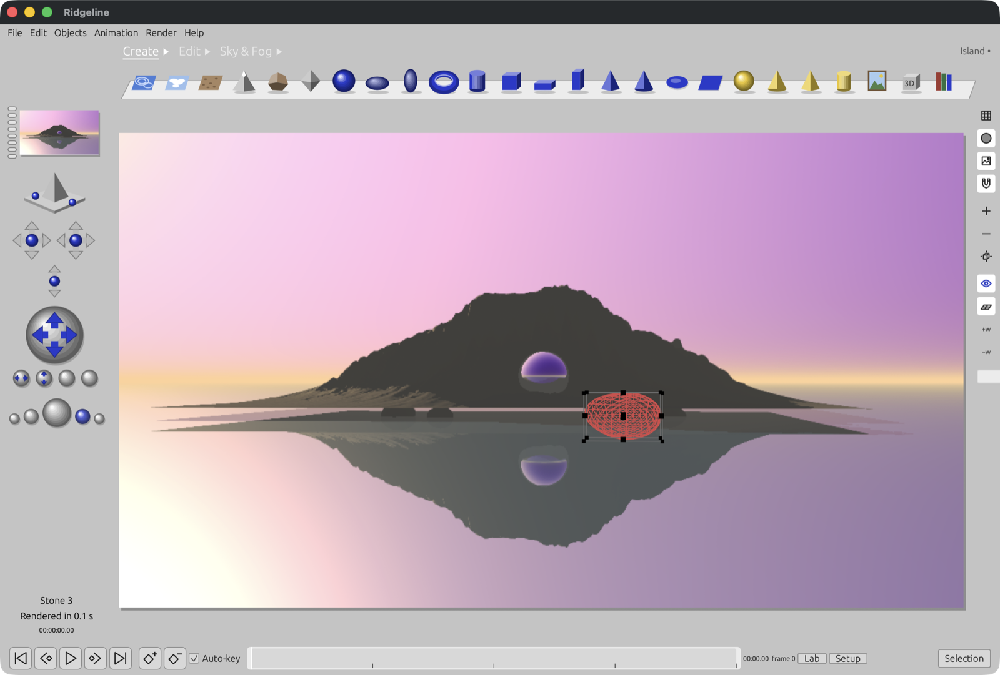
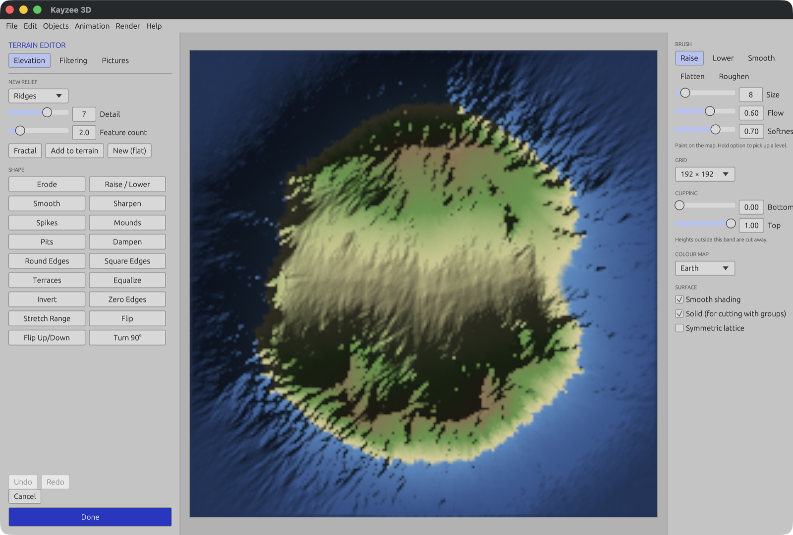
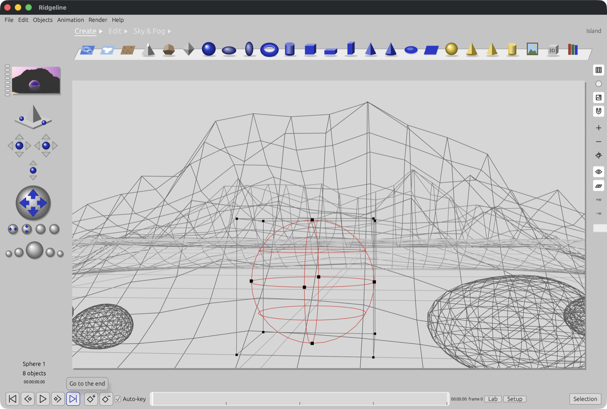
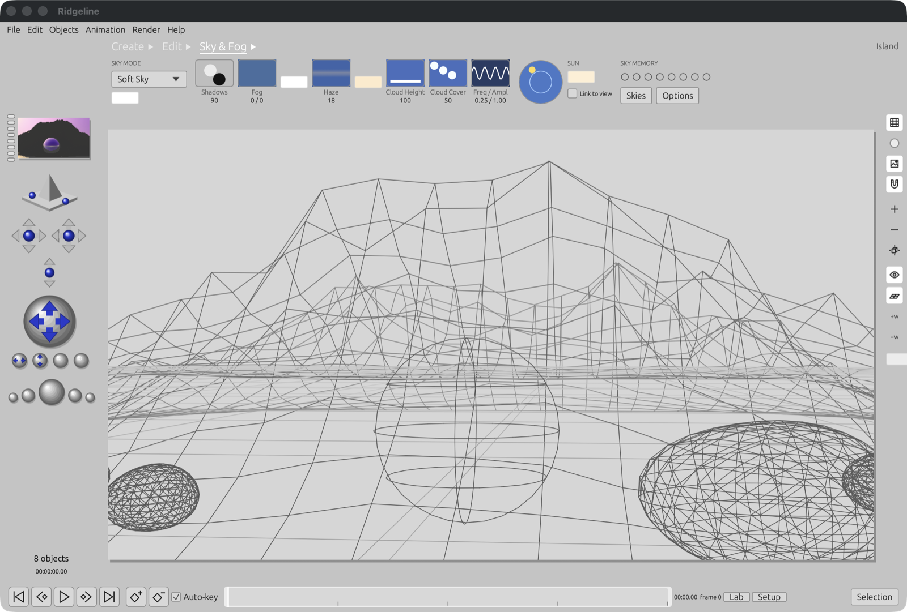

# Kayzee 3D

https://www.reddit.com/r/Bryce3D/comments/1y1xzts/comment/19sz9j242rew4/?screen_view_count=2

A landscape modeller and renderer for **macOS** (Apple Silicon and Intel), **Windows** and **Linux**, written in Rust.
Build scenes from terrains, water, primitives, lights and imported models, set the sky, and render.
It also opens old `.br3` and `.br5` scene files, so scenes made years ago can be worked on again
on a current machine.

**Who it's for:** people who want to keep making Bryce-style scenes, or open old ones, on a Mac or a
Linux machine. If you're on Windows, the original Bryce 3D still runs there; Kayzee 3D is an alternative,
not a replacement.

**How it was made, plainly:** Kayzee 3D was built by Kshitiz Mittal working with Claude (Anthropic's AI),
which wrote most of the code with Kshitiz directing. The hard part, reading old scene files and drawing them
the way the original did, is the work of the [stecyk3d](https://github.com/tatleoat/stecyk3d) renderer,
which this app is built on. Kayzee 3D adds the editor, the tools, the interface and the platform builds.

Kayzee 3D is heavily inspired by Bryce 3D, the 1990s landscape program: its way of working, its
workspace arrangement and its feel. It is a tribute written from scratch, not a copy of that program
(see the disclaimer at the end).

The idea to build it came from [this Instagram reel](https://www.instagram.com/reel/Df-_-wOP7vv/).
Credit to its creator for the spark.



| Wireframe workspace | Terrain Editor |
|---|---|
|  |  |

| Materials Lab | Sky & Fog |
|---|---|
|  |  |

## Download

Get the latest build from the [Releases page](https://github.com/lefotugrapher/kayzee-3d/releases/latest).

- **Mac** (Apple Silicon and Intel, macOS 12+): unzip, then right-click `Kayzee 3D.app` and choose **Open**
  the first time (the app is not notarised).
- **Windows 10/11 (64-bit):** unzip and run `Kayzee3D.exe`. If Windows shows "Windows protected your PC",
  choose **More info**, then **Run anyway** (the program is not signed).
- **Linux (64-bit x86):** `tar xzf Kayzee3D-Linux.tar.gz` and run `./kayzee3d`. Needs X11 or Wayland
  with OpenGL.

The Windows and Linux builds pass automated tests, but have had little use on real machines yet.
Tried it? Please file a [test report](https://github.com/lefotugrapher/kayzee-3d/issues/new?template=test-report.yml):
OS, graphics card, what broke, a screenshot.

## First run: unlock rendering with your Bryce 3D disc image

Everything works straight after download: building, editing, terrains, materials, animation, import
and export. **Rendering unlocks once you add your own Bryce 3D disc image (`.iso`).** No CD drive is
needed. Choose **File > Add Bryce 3D Disc Image…** (or the button on the first screen) and pick the file.
This takes about a second and is done once. A physical disc or an installed copy also works
(**File > Add From Disc or Folder…**).

Rendering needs a few data tables and presets that only the original disc holds. They belong to
Bryce's owners, so **none of them are in this repository or the downloads**; they are read from your
image and kept on your computer (`~/Library/Application Support/Kayzee 3D` on a Mac,
`%APPDATA%\Kayzee 3D` on Windows). It works with the Bryce 3D (Windows) disc.

## What it does

- **Create:** water, cloud and ground planes, terrains, stones, symmetric lattices, spheres, tori, cylinders,
  cubes, pyramids, cones, discs, squares, four kinds of light, trees, a posable human figure, picture objects.
- **Edit:** move, resize and rotate with handles or the Edit palette; align, randomise, land, group,
  boolean cuts, duplicate and replicate; object attributes, families, hide and lock.
- **Snapping:** to the ground, to other objects and to a grid. Dragging slides objects over the ground;
  Option/Alt-drag moves them straight up and down.
- **Sky & Fog:** sky modes, shadows, fog, haze, clouds, sun position, colours, saved skies.
- **Materials Lab:** thirteen channels, a texture per channel, a live preview, and a texture editor.
  Material and texture presets are read from your own disc's preset files.
- **Terrain Editor:** six kinds of fractal relief, eighteen shaping tools, five brushes, a height curve,
  pictures as heights, clipping, grid sizes from 16 to 1024.
- **Animation:** keyframes on objects, the camera, the sky and materials; a timeline, playback, a motion
  lab; movies as `.mov` (Mac) or `.avi`, or numbered frames.
- **Libraries:** the disc's material, texture, sky and object presets (`.obp`: shapes, meshes, groups,
  booleans, lights, terrains), with their own pictures. Add your own folders of `.obp` files too.
- **Classic look (optional):** Render > Classic Look draws the palettes with the original program's own
  artwork, read from your disc image at run time. None of that artwork is in this repository or the downloads.
- **Picture effects:** film grain, colour wash, saturation, contrast and dark corners.
- **Rendering:** three anti-aliasing levels, 360° panorama, object, distance and altitude masks, and a
  "stay rendered" mode that keeps the picture up while you edit and redraws it after each change.
- **Files:** opens `.br3` and `.br5`, saves its own `.ridge` format, imports OBJ, DXF, 3DS and 3DMF,
  saves pictures as PNG, BMP, TIFF or JPEG.

## Known limits

- Scenes are saved in Kayzee 3D's own format; it cannot write `.br3` files.
- Some old scenes are refused by the renderer, which stops rather than guess when it meets something it
  cannot draw exactly. The app shows the reason.
- Some old surfaces ask a texture for colour or bump it was never set to make. By default the app
  completes those textures so the scene renders; the result is close, not exact. This can be switched
  off in Render Options.
- Some tree presets in Rocks&Trees are refused by the renderer (too many overlapping leaves).
- The Classic look covers the Create and Edit palettes and the side columns; Sky & Fog and the labs keep
  Kayzee 3D's own controls.
- Trees are Kayzee 3D's own; metaballs (from later versions) are not supported.

## Updates

When it starts, the app asks GitHub for this project's latest release (at most once every six hours).
If a newer version is out you get a desktop notification and a line in the window with a link to the
download page. The request carries nothing about you. Turn it off under **Help > Look for updates at
start**, or look by hand with **Help > Check for Updates…**.

## Messages from the author

The app can show a short message from the author (a new tutorial, a heads-up) once, as a desktop notification and a line in the window. Each message is signed with the author's private key and the app checks the signature, so only the author can send one: a message that was edited or made by someone else is ignored. Messages are plain text with a few allowed links, and they expire. Nothing about you is sent. Messages are read from `news.json` in this repository. Turn this off with *Look for updates at start* (right-click the small preview).

## Build from source

You need a current Rust toolchain.

```sh
cargo build --release          # the program: target/release/kayzee3d
./tools/bundle.sh              # Mac: makes ../Kayzee 3D.app (needs the Xcode command line tools)
```

A Windows `.exe` can be cross-compiled from a Mac with [cargo-zigbuild](https://github.com/rust-cross/cargo-zigbuild):

```sh
rustup target add x86_64-pc-windows-gnu
cargo zigbuild --release --target x86_64-pc-windows-gnu
```

Useful checks that run without a window: `kayzee3d --selftest DIR`, `kayzee3d --checks DIR`,
`kayzee3d --snap-check`, `kayzee3d --update-check`.

## Publishing an update

```sh
tools/release.sh 0.3.0 "What changed in this version"
```

This sets the version, builds the Mac app and the Windows program, pushes the code and creates a GitHub
release with both downloads. The update notice in the app looks at releases, so a plain `git push`
without a release does not notify anyone.

## Credits

- Rendering and scene-file reading: [stecyk3d](https://github.com/tatleoat/stecyk3d) (MIT).
- Reading the disc's installer archive: [unshield](https://github.com/agrif/unshield) (MIT).
- Window and controls: [egui / eframe](https://github.com/emilk/egui).

### Thanks

- [Anton Marini (@vade)](https://github.com/vade) for testing with old Bryce backup files and reporting the crash in [#1](https://github.com/lefotugrapher/kayzee-3d/issues/1).

## Licence and disclaimer

Open source under the [MIT licence](LICENSE). Copyright (c) 2026 Kshitiz Mittal. Use it, change it,
share it.

Kayzee 3D is an independent project. It is not affiliated with, endorsed by or derived from the makers
or owners of Bryce. "Bryce" is a trademark of its owners and is used here only to say which files and
discs the app can read. The app contains no code, artwork or data from the original program; every
control and icon is drawn by this project's own code.
