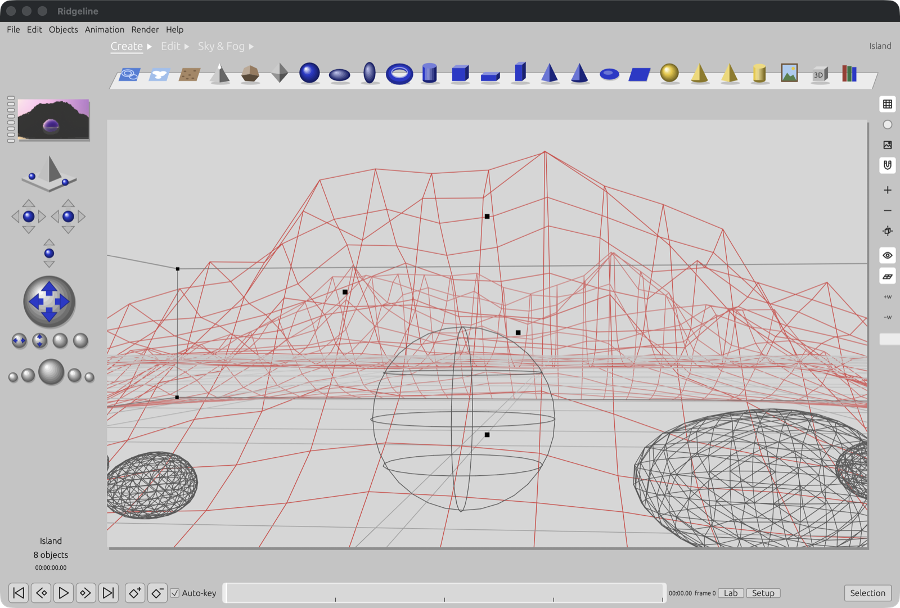

# Ridgeline

A landscape modeller and renderer for **macOS (Apple Silicon)** and **Windows**, written in Rust.
Build scenes from terrains, water, primitives, lights and imported models, set the sky, and render.
It also opens old `.br3` and `.br5` scene files, so scenes made years ago can be worked on again
on a current machine.


| Wireframe workspace | Terrain Editor |
|---|---|
|  |  |

| Materials Lab | Sky & Fog |
|---|---|
|  |  |

## Download

Get the latest build from the [Releases page](https://github.com/lefotugrapher/ridgeline/releases/latest).

- **Mac:** unzip, then right-click `Ridgeline.app` and choose **Open** the first time (the app is not notarised).
- **Windows 10/11 (64-bit):** unzip and run `Ridgeline.exe`. If Windows shows "Windows protected your PC",
  choose **More info**, then **Run anyway** (the program is not signed).

The Windows build has been checked with automated tests but has had little use on real hardware yet.
Please open an issue if something does not work.

## First run: set up from your own disc

Rendering needs a few data tables that only an original Bryce 3D disc holds. **None of that data is in
this repository or in the downloads.** In the app choose **File > Set Up From Disc…** and pick your disc,
a folder holding its files, or an installed copy. This is done once; the data stays on your machine
(`~/Library/Application Support/Ridgeline` on a Mac, `%APPDATA%\Ridgeline` on Windows).

You can build scenes without doing this, but not render them.

## What it does

- **Create:** water, cloud and ground planes, terrains, stones, symmetric lattices, spheres, tori, cylinders,
  cubes, pyramids, cones, discs, squares, four kinds of light, picture objects.
- **Edit:** move, resize and rotate with handles or the Edit palette; align, randomise, land, group,
  boolean cuts, duplicate and replicate; object attributes, families, hide and lock.
- **Snapping:** to the ground, to other objects and to a grid. Dragging slides objects over the ground;
  Option/Alt-drag moves them straight up and down.
- **Sky & Fog:** sky modes, shadows, fog, haze, clouds, sun position, colours, saved skies.
- **Materials Lab:** thirteen channels, a texture per channel, a live preview, and a texture editor.
  Material and texture presets are read from your own disc's preset files.
- **Terrain Editor:** six kinds of fractal relief, eighteen shaping tools, five brushes, a height curve,
  pictures as heights, clipping, grid sizes from 16 to 1024.
- **Animation:** keyframes on objects, the camera, the sky and materials; a timeline, playback, a motion
  lab; movies as `.mov` (Mac) or `.avi`, or numbered frames.
- **Rendering:** three anti-aliasing levels, 360° panorama, distance and altitude masks, and a
  "stay rendered" mode that keeps the picture up while you edit and redraws it after each change.
- **Files:** opens `.br3` and `.br5`, saves its own `.ridge` format, imports OBJ, DXF, 3DS and 3DMF,
  saves pictures as PNG, BMP, TIFF or JPEG.

## Known limits

- Scenes are saved in Ridgeline's own format; it cannot write `.br3` files.
- Some old scenes are refused by the renderer, which stops rather than guess when it meets something it
  cannot draw exactly. The app shows the reason.
- Some old surfaces ask a texture for colour or bump it was never set to make. By default the app
  completes those textures so the scene renders; the result is close, not exact. This can be switched
  off in Render Options.
- The disc's sky preset (`.bsk`) and object preset (`.obp`) files are not read.
- Trees and metaballs (from later versions) are not supported.

## Updates

When it starts, the app asks GitHub for this project's latest release (at most once every six hours).
If a newer version is out you get a desktop notification and a line in the window with a link to the
download page. The request carries nothing about you. Turn it off under **Help > Look for updates at
start**, or look by hand with **Help > Check for Updates…**.

## Build from source

You need a current Rust toolchain.

```sh
cargo build --release          # the program: target/release/ridgeline
./tools/bundle.sh              # Mac: makes ../Ridgeline.app (needs the Xcode command line tools)
```

A Windows `.exe` can be cross-compiled from a Mac with [cargo-zigbuild](https://github.com/rust-cross/cargo-zigbuild):

```sh
rustup target add x86_64-pc-windows-gnu
cargo zigbuild --release --target x86_64-pc-windows-gnu
```

Useful checks that run without a window: `ridgeline --selftest DIR`, `ridgeline --checks DIR`,
`ridgeline --snap-check`, `ridgeline --update-check`.

## Credits

- Rendering and scene-file reading: [stecyk3d](https://github.com/tatleoat/stecyk3d) (MIT).
- Reading the disc's installer archive: [unshield](https://github.com/agrif/unshield) (MIT).
- Window and controls: [egui / eframe](https://github.com/emilk/egui).

## Licence and disclaimer

Ridgeline's own code is under the [MIT licence](LICENSE).

Ridgeline is an independent project. It is not affiliated with, endorsed by or derived from the makers
or owners of Bryce. "Bryce" is a trademark of its owners and is used here only to say which files and
discs the app can read. The app contains no code, artwork or data from the original program; every
control and icon is drawn by this project's own code.
